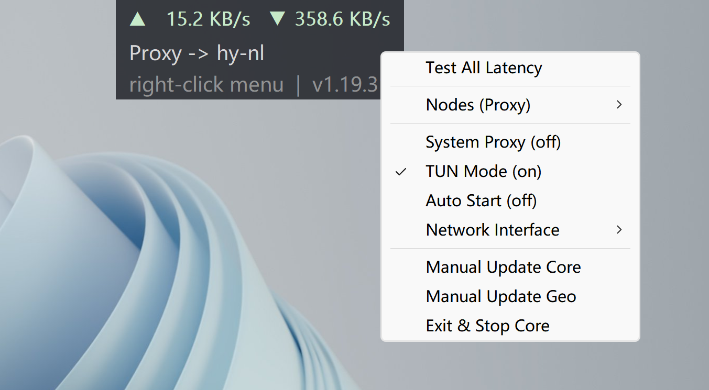

# mihomo-widget

Windows 桌面上的一块 **mihomo 悬浮控件**：常驻置顶的小面板，用 GDI 手绘、握手写的 Win32 互操作层——Zig 0.16 实现，不依赖 Electron / .NET / Qt。



## 它做什么

- **实时网速**：只统计**物理网卡**的字节数（排除回环 / TUN / 无 MAC 的虚拟口，也排除 NDIS filter 镜像），自动换挡显示 KB/s 或 MB/s。
- **节点延迟**：按分组逐节点即时测速（`GET /proxies/{name}/delay`），失败的节点在面板上标出来。
- **右键菜单**：切换分组 / 节点、开关 TUN、开关系统代理、开机自启、选择计量网卡、手动更新核心与 geodata、`Exit & Stop Core`。
- **核心与界面解耦**：延迟 / TUN / 停核心 / 状态轮询都在后台 worker（单槽）里跑，UI 线程只读快照并绘制，不卡界面。
- **核心离线也能操作**：配置写错导致核心起不来时右键菜单照样弹出（依赖核心的项置灰、节点子菜单省略），`Exit & Stop Core` 永远可用——不会变成一个关不掉的悬浮窗。
- **停核心先关 TUN**：TUN 是核心持有的虚拟网卡 + 默认路由，硬杀可能留下死网卡把整机流量黑洞掉；控件先让核心拆干净再杀，并在杀完后复查是否真的停掉了。
- **置顶守护**：Windows 会在工作站解锁 / 分辨率变更 / DWM 重建 Z-order 后把面板挤到普通窗口之下，控件定时巡检并静默修回（不抢焦点）。

## 运行要求

- Windows 10 / 11 x64（只在 Windows 上构建与运行）。
- 使用 TUN 需要管理员权限：发布包里的 exe 带 `requireAdministrator` manifest。

## 安装

发布包（`mihomo-widget-vX.Y.Z-x86_64.zip`）解压后是**两层结构**：

```
mihomo-widget.exe          ← 控件（运行时多一份 mihomo-widget.log）
mihomo-widget.conf         ← 控件 UI 配置（模板，可不改）
mihomo\
  mihomo.exe               ← 核心
  config.yaml.example      ← 主配置模板
  direct.yaml              ← 直连白名单（rule-provider）
  GeoIP.dat  GeoSite.dat   ← geodata
```

首次使用：

1. 把 `mihomo\config.yaml.example` 复制成 `mihomo\config.yaml`，把末尾 `proxies:` 段换成你自己的节点（包里是占位地址 `1.2.3.4` / `change_me`，**故意不提供可直接运行的配置**）。
2. 双击 `mihomo-widget.exe`，控件会拉起同目录的 `mihomo\mihomo.exe`。

**升级别整目录替换**：新包里没有你的 `config.yaml` 与 `cache.db`（也不会覆盖 `mihomo-widget.conf` 里的个人状态），整目录替换会丢主配置和已存的分组选择。通常只替换 `mihomo-widget.exe`、`mihomo\mihomo.exe`，想更新 geodata / 白名单时再带上对应文件。

## TUN

**开机状态只有一个来源**：`mihomo\config.yaml` 里的 `tun.enable`。核心在启动阶段就建网卡（早于它自己的首拨与组测速），这样"运行中建网卡把正在拨号的 hysteria2/QUIC 连接绑到 TUN 自己的地址 → 自环 → 该节点约 1 分钟不可达"这条路从结构上就不存在。菜单里的 `TUN Mode` 是运行时 PATCH，只对本次运行有效、不落盘。

万一仍撞上自环（例如在菜单里热切换 TUN），控件会在 TUN 就位后探一次：一旦"QUIC 类节点探不通、而 TCP 类节点至少一个通"，就 `PUT /configs {}` 就地重载（重建 outbound，hy 重拨），把等待从 ~70–90s 压到十几秒——代价是这次重载会断开连接约 1–2 秒。

## 配置

- **`mihomo-widget.conf`**：面板字体 / 透明度 / 尺寸 / 网速刷新间隔与单位 / 颜色 / 置顶巡检间隔。删掉行首的 `#` 即生效，改完重启控件。`window_x` / `window_y` / `sysproxy` / `nic_ifindex` 是控件自己维护的运行时状态，别手改。**这里没有 TUN 键**（原因见上一节）。
- **`mihomo\config.yaml`**：主配置——节点、分组、规则、TUN，写法见 `config.yaml.example`。

## 从源码构建

工具链固定 Zig 0.16.0（`.tools\zig\zig-x86_64-windows-0.16.0\zig.exe`）：

```bat
scripts\build.bat            :: Debug  → app\zig-out\bin\mihomo-widget.exe
scripts\build_release.bat    :: admin release + 打包 zip → release\
```

发布脚本的版本号取自 `docs\CHANGELOG.md` 最新的 `## vX.Y.Z` 标题，并在打包前跑 `zig build docs-check`（文档与源码符号 / 端点 / conf 键不一致就拒绝打包）。

## 文档

- `docs\API-REFERENCE.md`：各模块公开符号、mihomo REST 端点、conf 键、Win32 extern 分组与定位表——由 `docsgen` 用 `std.zig.Ast` 解析源码生成，`zig build docs-check` 反向校验。
- `docs\CHANGELOG.md`：用户可感知的变更，也是发布版本的唯一来源。
- `AGENTS.md`：架构边界与已确立的关键决策（为什么这么写、哪些方案已证伪）。
- `docs\zig-0.16-guide.md`：Zig 0.16 API 变更速查。

## 许可

GPL-3.0，见 `LICENSE`。
